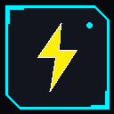

# ⚡ CYBERCLIP // HUD Notes & Web Clipper (v1.2.0)

> **Extensión de Navegador Manifest V3** con interfaz HUD Cyberpunk de alta tecnología para el guardado rápido de fragmentos, citas y notas indexadas por URL, equipada con **sistema de favoritos blindados (★)**, **paleta configurable de 6 colores vinculada a etiquetas dinámicas**, **resaltado neón in-page** y **selector rectangular con bordes amarillo eléctrico y fondo azul oscuro**.



---

## 🚀 Resumen del Proyecto

**CYBERCLIP** es una extensión de navegador construida bajo la especificación moderna **Google Chrome Extensions Manifest V3**. Permite a desarrolladores, investigadores y analistas capturar fragmentos de texto seleccionados mediante **3 métodos ultrarrápidos**:
1. **Mini-Barra Flotante In-Page con Paleta de Colores**: Al seleccionar cualquier texto en cualquier sitio web, aparece un mini-rectángulo biselado con **bordes amarillo eléctrico (`#FCEE0A`)** y **relleno azul oscuro (`#0b101d`)**, con el botón `[⚡ CLIP]` y 6 ranuras de color vinculadas a sus etiquetas correspondientes. Un solo clic en cualquier color guarda el fragmento asignándole tanto ese color como su etiqueta.
2. **Atajo de Teclado Global (`Alt + C`)**: Captura la selección activa instantáneamente con el color y etiqueta activos y muestra un HUD Toast en la esquina inferior.
3. **Menú Contextual del Ratón (Clic Derecho)**: Opción `⚡ Capturar fragmento a CyberClip`.

Todo se persiste en la base de datos asíncrona local `chrome.storage.local`. Además, cuando vuelves a visitar cualquier página web, el **Content Script** identifica tus fragmentos guardados y los resalta con su color específico asignado (**resplandor y subrayado neón dinámicos**), mostrando un **tooltip holográfico** con tus notas personales al pasar el ratón.

---

## ✨ Novedades de la Versión 1.2.0

### 1. ★ Sistema de Favoritos con Blindaje Anti-Purga
- **Estrella Amarilla (`★`, Cyber Yellow `#FCEE0A`)**:
  - En la pestaña **01. NOTA RÁPIDA**, activa o desactiva la estrella para marcar notas como favoritas antes de guardarlas.
  - En cada tarjeta del **Banco de Datos**, un botón de estrella permite conmutar el estado de favorito con 1 clic sin recargar.
- **Filtro Rápido `[★ FAVORITOS]`**:
  - Nuevo botón de alcance en la barra de herramientas del Banco de Datos junto a `[ESTA PÁGINA]` y `[TODO EL BANCO]`.
- **Protección contra Purga Masiva de Memoria**:
  - Al ejecutar una purga en la pestaña de Telemetría, los clips favoritos están **estrictamente blindados** y **NUNCA** se eliminan salvo que el usuario marque de forma explícita la casilla de confirmación *"INCLUIR FAVORITOS PROTEGIDOS"*.

### 2. 🎨 Paleta Configurable de 6 Colores & Etiquetas Asociadas
- **Pestaña `04. CONFIG` (Configuración HUD)**:
  - **6 Ranuras de Color Personalizables**:
    - Ranura 1: Amarillo Neón (`#FCEE0A`) ➔ Etiqueta `#IDEA`
    - Ranura 2: Cian Eléctrico (`#00F0FF`) ➔ Etiqueta `#RESEARCH`
    - Ranura 3: Verde Neón (`#00FF66`) ➔ Etiqueta `#DEV`
    - Ranura 4: Magenta Neón (`#FF007F`) ➔ Etiqueta `#BUG`
    - Ranura 5: Naranja Ámbar (`#FFA500`) ➔ Etiqueta `#LECTURA`
    - Ranura 6: Azul Eléctrico (`#0070FF`) ➔ Etiqueta `#DOCS`
  - Cada ranura dispone de un selector de color interactivo (`<input type="color">`), campo HEX editable y un campo de texto para personalizar el nombre de la etiqueta asociada.
  - Botón para guardar configuración y botón para restablecer los valores de fábrica.
  - Interruptor HUD para activar/desactivar el motor de resaltado in-page en cualquier momento.

### 3. 🔲 Mini-Selector Rectangular de Colores
- Diseñado según las especificaciones del usuario:
  - **Bordes amarillo eléctrico (`#FCEE0A`)**
  - **Relleno azul oscuro (`#0b101d`)**
  - Botones de color interactivos con previsualización de la etiqueta en hover y clic directo para guardar.
  - Presente tanto en la barra flotante de páginas web (`content.js`) como en la pestaña de Nota Rápida del Popup.

### 4. 🌈 Resaltado Dinámico Multicromático In-Page
- El motor DOM in-page (`content.js` y `content.css`) aplica variables CSS personalizadas (`--clip-color`, `--clip-bg`, `--clip-glow`) para pintar cada fragmento con el color exacto que el usuario le asignó.

---

## 🎨 Cumplimiento de Especificaciones de Diseño (DESIGN.md)

Siguiendo las directivas de `/home/antigravity/DESIGN.md` y las **Directivas Especiales para Carol**:

- **Paleta de Colores Cyberpunk:**
  - `Cyber Yellow` (`#FCEE0A`): Llamadas a la acción principales (CTA), estrellas de favoritos, alertas y acentos principales.
  - `Electric Cyan` (`#00F0FF`): Telemetría, escáner de URL, bordes activos y estados online.
  - `Neon Crimson` (`#FF003C`): Acciones destructivas, purga de memoria y avisos críticos.
  - `Deep Void` (`#08090C`): Fondo principal del viewport y contraste extremo.
  - `Armor Plate` (`#12151D`): Placas y módulos contenedores de la interfaz HUD.
  - `Dark Blue Fill` (`#0b101d`): Fondo de selectores de color rectangulares y diálogos modales.
  - `Holo Amber` (`#FFA500`): Metadatos auxiliares, dominios y contadores secundarios.
- **Directiva Especial de Bordes Biselados (Carol):**
  - Implementación estricta del corte a 45 grados mediante CSS:
    ```css
    clip-path: polygon(0 0, calc(100% - 10px) 0, 100% 10px, 100% 100%, 10px 100%, 0 calc(100% - 10px));
    ```
  - Aplicado en: barra flotante, botones primarios, tarjetas del banco, escáner de URL, tooltip holográfico, modal de purga y pestañas HUD.
- **Efectos Visuales:** Scanlines CRT horizontales, rejilla holográfica, resplandores neón y tipografía técnica (`Orbitron`, `Rajdhani` y `Share Tech Mono`).

---

## 📁 Estructura del Proyecto

```text
cyberclip-extension/
├── manifest.json         # Configuración Manifest V3 (v1.2.0, comandos, content scripts)
├── background.js        # Service Worker: menús contextuales, comandos y telemetría
├── content.js           # Content Script v1.2.0: barra flotante con paleta, tags y resaltador
├── content.css          # Estilos: mini-selector azul/amarillo, tooltip HUD y glows neón
├── popup.html           # Interfaz HUD modular: 4 pestañas, selector rectangular y modal
├── popup.css            # Estilos Cyberpunk de alto contraste con clip-path a 45°
├── popup.js             # Lógica reactiva: favoritos, paleta configurable, filtros y purga
├── demo.html            # Banco interactivo de pruebas v1.2.0 y simulador contextual
├── create_icons.py      # Generador autónomo de iconos PNG y SVG
├── README.md            # Documentación completa y manual de instalación
└── icons/
    ├── icon16.png       # Icono 16x16 px para la barra de herramientas
    ├── icon48.png       # Icono 48x48 px para el administrador de extensiones
    ├── icon128.png      # Icono 128x128 px para la Chrome Web Store y diálogos
    └── icon.svg         # Vector maestro escalable con efectos de glow
```

---

## 💻 Instrucciones Paso a Paso para Instalar en Chrome / Edge

### Paso 1: Abrir la página de extensiones del navegador
- **En Google Chrome / Chromium / Brave:**
  Escribe en la barra de direcciones:
  ```text
  chrome://extensions/
  ```
- **En Microsoft Edge:**
  Escribe en la barra de direcciones:
  ```text
  edge://extensions/
  ```

### Paso 2: Activar el Modo Desarrollador
- En la esquina superior derecha de la página, activa el interruptor que dice **"Modo de desarrollador"** (o *"Developer mode"*).
- Al activarlo, verás aparecer una nueva barra de herramientas con botones adicionales.

### Paso 3: Cargar la extensión descomprimida
1. Haz clic en el botón **"Cargar descomprimida"** (*"Load unpacked"*).
2. En el explorador de archivos que se abrirá, navega y selecciona la carpeta del proyecto:
   ```text
   /home/antigravity/cyberclip-extension
   ```
3. Haz clic en **"Seleccionar carpeta"** (*"Select folder"*).

*(También dispones del archivo empaquetado `cyberclip-extension.zip` en `/home/antigravity/` si deseas distribuirlo directamente).*

### Paso 4: Fijar la extensión para fácil acceso
1. En la barra de herramientas de tu navegador, haz clic en el icono de la pieza de rompecabezas (Extensiones).
2. Busca **"CYBERCLIP // HUD Notes & Clipper"**.
3. Haz clic en el icono de la chincheta (Pin) para fijar el icono amarillo y cian en tu barra.

---

## 🧪 Atajos de Teclado y Pruebas

| Atajo | Acción | Descripción |
| :--- | :--- | :--- |
| `Alt + C` | **⚡ Captura Instantánea** | Guarda el texto seleccionado en la página web actual con color y tag activos en segundo plano. |
| `Alt + N` | **Abrir HUD Terminal** | Despliega instantáneamente el Popup de CyberClip sin mover el ratón. |
| `Selección` | **Barra Flotante con Paleta** | Mini-barra azul oscuro con borde amarillo para elegir color y tag en 1 clic. |
| `Clic Derecho` | **Menú Contextual** | Opción *"Capturar fragmento a CyberClip"*. |

---

## 🔒 Privacidad y Rendimiento

- **100% Local (Offline-first):** CYBERCLIP no envía ningún dato a servidores externos. Todo el contenido reside de manera privada en tu navegador a través de `chrome.storage.local`.
- **Cero dependencias pesadas:** Construido enteramente en JavaScript moderno ES6+, HTML5 semántico y CSS3 puro con aceleración por hardware.
- **Sin fugas de memoria:** El Service Worker entra en estado de suspensión cuando no está procesando eventos de captura.

---

> Desarrollado por **Carol** // Frontend & Chrome Extension Architecture // *High-Tech Cyberpunk HUD Design v1.2.0*
