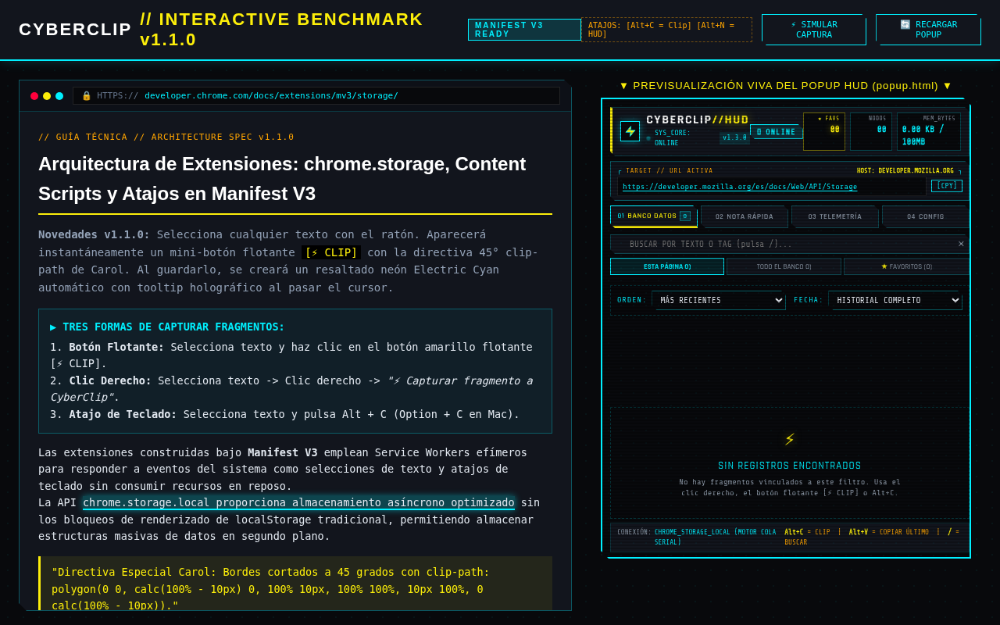
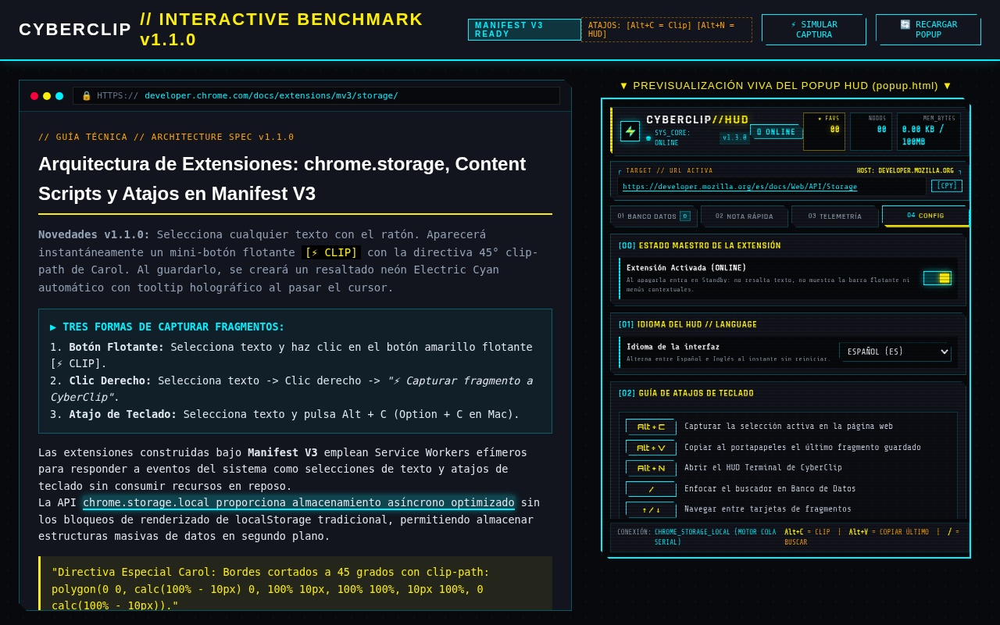
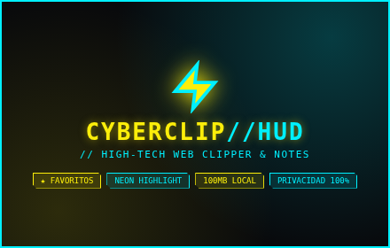

# ⚡ CYBERCLIP // HUD Notes & Clipper v1.3.0

> **High-Tech Cyberpunk HUD Web Clipper y gestor de notas indexadas por URL con estética Cyber Yellow `#FCEE0A`, Electric Cyan `#00F0FF`, Neon Crimson `#FF003C` y Deep Void `#08090C`, directiva de bordes cortados a 45° de Carol, motor de resaltado in-page y almacenamiento local de alta capacidad (100 MB).**

[](manifest.json)
[](STORE_LISTING.md)
[](PRIVACY.md)
[](fonts/OFL.txt)

---

## 📸 Capturas de Pantalla & Recursos de Publicación

| Panel HUD Principal (1280x800) | Panel de Configuración (1280x800) | Promo Tile Oficial (440x280) |
|:---:|:---:|:---:|
|  |  |  |

Todos los recursos listos para la Chrome Web Store están en [`store/`](store/):
- `screenshot-1-hud.png` (1280×800)
- `screenshot-2-config.png` (1280×800)
- `screenshot-3-telemetry.png` (1280×800)
- `promo-tile-440x280.png` (440×280)

---

## 🚀 Novedades de la Versión 1.3.0

1. **Pestaña 01. BANCO DE DATOS por defecto:** Al abrir el HUD terminal (`Alt+N` o clic en el icono) accedes inmediatamente a tu biblioteca de fragmentos sin pasos intermedios.
2. **Motor de Almacenamiento con Único Escritor (`lib/store.js`):** Cola serializada de promesas en `background.js` que elimina por completo las condiciones de carrera entre pestañas y content scripts.
3. **Migración Automática Segura:** Sanea registros legacy sin pérdida de datos del usuario y elimina de forma limpia los fragmentos seed de ejemplo.
4. **Bilingüe (Español / Inglés):** Selector instantáneo de idioma en la pestaña `04. CONFIG` con cadenas sincronizadas en `_locales/es` y `_locales/en`.
5. **Edición en Línea de Fragmentos:** Edita contenido, notas personales y etiquetas directamente desde cualquier tarjeta con el botón `[EDITAR]`.
6. **Deshacer Borrado (Undo Toast):** Notificación flotante de 5 segundos con botón `[DESHACER]` para recuperar fragmentos eliminados por error.
7. **Orden y Filtros por Fecha:** Ordena por más recientes, más antiguos o alfabéticamente; filtra por hoy (24h), últimos 7 días o todo el historial.
8. **Atajos Globales de Teclado:**
   - <kbd>Alt + C</kbd>: Capturar la selección actual en la página web.
   - <kbd>Alt + V</kbd>: Copiar al portapapeles el último fragmento guardado (mediante documento `offscreen`).
   - <kbd>Alt + N</kbd>: Abrir el HUD Terminal de CyberClip.
   - <kbd>/</kbd>: Enfocar instantáneamente el buscador dentro del HUD.
   - <kbd>↑</kbd> / <kbd>↓</kbd>: Navegar entre tarjetas de fragmentos.
   - <kbd>Supr</kbd>: Eliminar la tarjeta enfocada (con opción de deshacer).
9. **Modo Standby Maestro (⏻ ONLINE / STANDBY):** Interruptor en cabecera y en CONFIG para apagar temporalmente la extensión (sin resaltados, sin menús, badge rojo `OFF`).
10. **Resaltador Neón Multi-nodo Robusto:** Resalta frases largas (hasta 4000 caracteres) incluso cuando cruzan varios nodos DOM en SPAs (React, Vue, Next.js).
11. **Lista de Sitios Bloqueados (Blocklist):** Configura dominios donde CyberClip nunca actuará (ej. sitios bancarios o confidenciales).
12. **Fuentes 100% Locales (OFL):** Orbitron, Rajdhani y Share Tech Mono empaquetadas en `woff2` dentro de la extensión, sin peticiones externas a Google Fonts.
13. **Tope Estricto de 100 MB (104.857.600 bytes):** Monitoreo en tiempo real de bytes usados en el panel de Telemetría.
14. **Blindaje de Favoritos (★):** Los fragmentos marcados con estrella amarilla jamás se eliminan en purgas masivas a menos que se autorice explícitamente.

---

## 📦 Instalación Local (Modo Desarrollador)

1. Abre Google Chrome o cualquier navegador compatible (Brave, Edge, Chromium).
2. Entra en `chrome://extensions/`.
3. Activa la casilla **"Modo de desarrollador"** (esquina superior derecha).
4. Haz clic en **"Cargar descomprimida"** (Load unpacked).
5. Selecciona la carpeta de este repositorio: `/home/antigravity/cyberclip-extension` (o la subcarpeta `dist/`).
6. ¡Listo! El icono de CyberClip aparecerá en tu barra de herramientas.

---

## 🛠️ Empaquetado para la Chrome Web Store

Para generar el archivo ZIP limpio listo para subir a la consola de desarrolladores de Google:

```bash
npm run build
```

Esto generará `cyberclip-v1.3.0-store.zip` excluyendo tests, scripts, herramientas y archivos temporales.

---

## 🧪 Pruebas Unitarias & Validación

```bash
npm test     # Ejecuta la suite de pruebas unitarias (9/9 pass)
npm run lint # Valida la sintaxis de todos los archivos JS
```

---

## 🔒 Privacidad

Consulta el documento completo en [PRIVACY.md](PRIVACY.md). CYBERCLIP almacena todos los datos en local dentro de `chrome.storage.local`. No recopila datos personales, no utiliza analíticas externas y no se comunica con ningún servidor.

---

## 📄 Licencia

MIT License. Fuentes empaquetadas bajo licencia SIL Open Font License (OFL) en [fonts/OFL.txt](fonts/OFL.txt).
